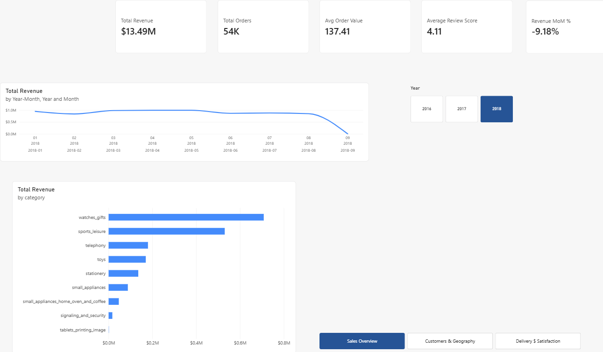
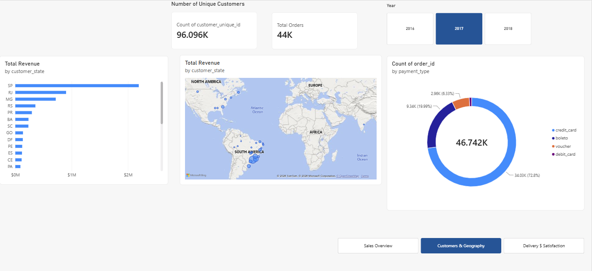
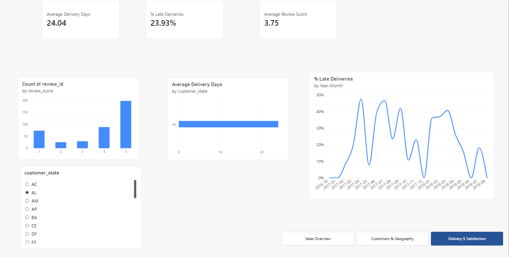

# Olist E-Commerce Dashboard (Power BI)

An interactive three-page Power BI dashboard analyzing sales, customers and delivery performance for the Olist Brazilian e-commerce dataset.

## Screenshots

## Business questions

- How are revenue and orders trending over time, and which product categories drive sales?
- Where are customers located, and how do they pay?
- How long do deliveries take, how often are they late, and does lateness affect review scores?

## Key insights

- [Add finding 1, with numbers]
- [Add finding 2, with numbers]
- [Add finding 3, for example late orders vs. average review score]

## What's in the dashboard

- **Sales Overview:** revenue, orders, average order value, monthly revenue trend, top 10 categories
- **Customers & Geography:** revenue and customers by state, payment methods
- **Delivery & Satisfaction:** delivery time, % late deliveries, review score distribution, late vs. on-time review scores
- Year slicer synced across pages, cross-filtering, page navigator and a custom tooltip page

## How it was built

- **Power Query:** loaded 8 tables, fixed data types, added `Delivery Days` and `Is Late` columns, merged English category names
- **Data model:** one-to-many relationships across orders, items, customers, products, payments, reviews, plus a Calendar table
- **DAX:** measures for revenue, orders, average order value, unique customers, review score, delivery days, % late and month-over-month growth (see `docs/measures.md`)

## Data

[Brazilian E-Commerce Public Dataset by Olist](https://www.kaggle.com/datasets/olistbr/brazilian-ecommerce) on Kaggle, licensed CC BY-NC-SA 4.0. The raw CSV files are not included; download them from Kaggle.

## How to open

Download `olist_dashboard.pbix` and open it in Power BI Desktop (Windows).

## Notes

Built as a learning project with step-by-step guidance from Claude (Anthropic).

## Author

[Your name] · [LinkedIn link]
